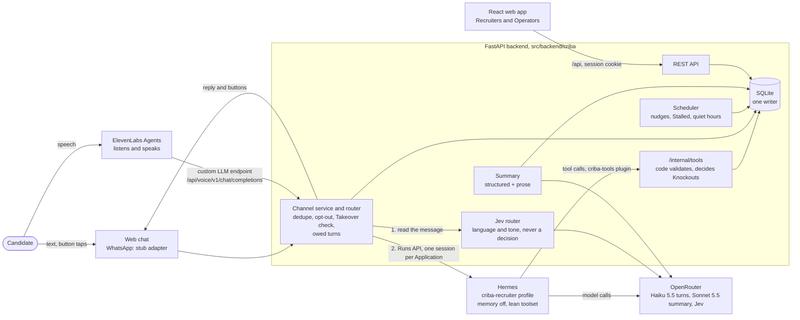

# Criba

AI screening of frontline job Candidates over chat, with a tracker for the Client's Recruiters. Vocabulary: [`CONTEXT.md`](CONTEXT.md). Decisions: [`docs/decisions/`](docs/decisions/README.md). Measurements: [`docs/evidence/`](docs/evidence/).

Measured on this code: 20 of 20 screening flows pass against the real models in the [live smoke run](docs/evidence/live-smoke.md); Claude Haiku 5.5 screens a Candidate for $0.0074 against $0.0535 all-Sonnet ([model comparison](docs/evidence/model-comparison.md), key design decision 5); on the stub model the backend stays at a third of a core at 18 times the expected peak load ([load results](docs/evidence/load-results.md)).

## Deliverables

| Deliverable | Where |
|---|---|
| Git repository with the source code | This repository: the code and everything that builds, runs, tests and checks it. The [code map](#code-map) says what lives where. |
| Process design (Phase 1) | [`docs/case/phase-1-process-design-short.docx`](docs/case/phase-1-process-design-short.docx) (also as [`.md`](docs/case/phase-1-process-design-short.md)). The full design: [`phase-1-process-design.md`](docs/case/phase-1-process-design.md); field-level rules: [`phase-1-detailed-spec.md`](docs/case/phase-1-detailed-spec.md). |
| Demo video | [Watch the demo](https://www.loom.com/share/48ecad1d0f3b4ed695b248bc3d8ddab3) |
| README | This file: [setup](#setup), [architecture overview](#architecture-overview), [key design decisions](#key-design-decisions) (each with its record in [`docs/decisions/`](docs/decisions/README.md)), [potential improvements](#potential-improvements). |
| Sample conversations | [`docs/samples/`](docs/samples/): eight real conversations on Claude Haiku 5.5, each with its transcript, events and Application JSON. |

## Setup

### Run locally

Needs Docker with Compose v2. For development outside Docker: [uv](https://docs.astral.sh/uv/) and Node 22.22 or later.

1. Create the secret files from the templates. They are gitignored; never commit them.
   ```sh
   for f in secrets/*.example; do cp "$f" "${f%.example}"; done
   openssl rand -hex 32 > secrets/hermes_api_server_key.txt
   openssl rand -hex 32 > secrets/criba_tools_secret.txt
   openssl rand -hex 32 > secrets/criba_booking_secret.txt
   openssl rand -base64 18 > secrets/criba_seed_password.txt
   openssl rand -hex 32 > secrets/criba_voice_secret.txt
   openssl rand -hex 32 > secrets/criba_voice_llm_secret.txt
   # Put a real OpenRouter key in secrets/openrouter_api_key.txt only when you need real model calls.
   # Put a real ElevenLabs API key in secrets/elevenlabs_api_key.txt only when you need real voice calls.
   # ElevenLabs issues the post-call webhook secret when the HMAC webhook is created;
   # copy it into secrets/elevenlabs_webhook_secret.txt.
   ```

   | Secret file | Used by | What |
   |---|---|---|
   | `hermes_api_server_key.txt` | backend, hermes | key of the Hermes API server (`/p/<profile>/v1/runs`) |
   | `criba_tools_secret.txt` | backend, hermes | shared secret of the `criba-tools` plugin (`/internal/tools`) |
   | `criba_booking_secret.txt` | backend | signs booking links, both the agent's and the Recruiter's |
   | `openrouter_api_key.txt` | backend, hermes | OpenRouter: the agent's model, and the summary's prose (never called in sim mode) |
   | `criba_seed_password.txt` | backend | password of the SYNTHETIC seeded users (`operator@criba.example`, `recruiter.<city>@sazon.example`) |
   | `elevenlabs_api_key.txt` | backend | ElevenLabs API: voice sessions and agent config (only needed with `CRIBA_VOICE=on`) |
   | `criba_voice_secret.txt` | backend | signs voice-session tokens |
   | `criba_voice_llm_secret.txt` | backend | bearer ElevenLabs sends to the custom-LLM endpoint |
   | `elevenlabs_webhook_secret.txt` | backend | verifies the post-call webhook signature; issued by ElevenLabs, copied here |

   At startup the backend migrates the database and, with `CRIBA_SEED=1` (set in Compose), seeds the SYNTHETIC Client, Locations, slots and users.
2. Start everything:
   ```sh
   docker compose up -d --build
   docker compose ps          # all three services should become healthy
   ```
3. Open http://localhost:8080 (set `CRIBA_WEB_PORT` to change it). Only `web` publishes a port: nginx serves the React app and proxies `/api` (including the web chat at `/api/chat`) to the backend. The backend and Hermes are reachable only on the Compose networks.

Services:

| Service | What | Inside the network |
|---|---|---|
| `web` | nginx with the Vite build | `:80`, published on the host |
| `backend` | FastAPI (uvicorn); SQLite on the `sqlite` volume at `/data/criba.db` | `backend:8000` |
| `hermes` | Official Hermes image with the API server on; home on the `hermes-home` volume at `/opt/data` | `hermes:8642` |

Containers get only the variables listed in `docker-compose.yml`, never the host shell environment, so no messaging-platform token reaches Hermes.

### Development without Docker

```sh
# The backend needs a database path and the Hermes key file (it migrates the database at startup):
CRIBA_DB_PATH=/tmp/criba.db CRIBA_HERMES_API_KEY_FILE=secrets/hermes_api_server_key.txt \
  CRIBA_TOOLS_SECRET_FILE=secrets/criba_tools_secret.txt CRIBA_SEED=1 \
  CRIBA_SEED_PASSWORD_FILE=secrets/criba_seed_password.txt \
  uv run --project src/backend uvicorn criba.app:app --reload      # backend on :8000
npm --prefix src/web install && npm --prefix src/web run dev         # web on :5173, proxies /api (including /api/chat) to :8000
```

The web app calls only relative `/api/...` paths and authenticates with the `criba_session` cookie, so the Vite dev server proxies `/api` (streams included) to one backend: `CRIBA_BACKEND_URL`, default `http://localhost:8000`. To run the dev server against a Compose stack instead, point it at the stack's web port, whose nginx proxies `/api` in turn: `CRIBA_BACKEND_URL=http://localhost:8080 npm --prefix src/web run dev`.

### Checks

```sh
uv run --project src/backend ruff check src/backend
uv run --project src/backend pytest -q
npm --prefix src/web run lint && npm --prefix src/web test && npm --prefix src/web run build
docker compose config -q && docker compose build
src/scripts/check_contracts.sh   # the contract gate
src/scripts/check.sh full        # everything CI runs, in the dev container (lint, types, both test suites
                                 # with coverage ratchets, the floor guard, gitleaks, Semgrep, osv-scanner)
```

### End-to-end tests on the sim stack

`src/tests/e2e/` runs personas through the real backend, Hermes and the stub model (no real model is called). Every test skips unless both `CRIBA_E2E_BASE_URL` and `CRIBA_E2E_SEED_PASSWORD_FILE` are set. Start a sim stack under its own Compose project and port, so it never touches your main stack, and tear it down afterwards:

```sh
CRIBA_WEB_PORT=18095 docker compose -p criba-e2e -f docker-compose.yml -f docker-compose.sim.yml up -d --build --wait
CRIBA_E2E_BASE_URL=http://localhost:18095 \
  CRIBA_E2E_SEED_PASSWORD_FILE=secrets/criba_seed_password.txt \
  uv run --project src/backend pytest src/tests/e2e -q -m e2e
docker compose -p criba-e2e -f docker-compose.yml -f docker-compose.sim.yml down -v
```

The sim clock is global to the backend, so the tests run one persona at a time. Sim mode is described in ADR 0036.

The browser specs in `src/web/tests/e2e/` (Playwright) use the same two variables and the same kind of stack: the Operator flow (Claim, Takeover, hand-back, Approval), the Recruiter's scope with no cost data, and the test chat. Candidate activity goes through the web chat API, so the agent is the stub model. They run against the stack's built web image, so rebuild it after changing `src/web/`:

```sh
npm --prefix src/web exec -- playwright install chromium   # once
# The password path is absolute: npm runs the script from src/web.
CRIBA_E2E_BASE_URL=http://localhost:18095 \
  CRIBA_E2E_SEED_PASSWORD_FILE=$PWD/secrets/criba_seed_password.txt \
  npm --prefix src/web run e2e
```

## Architecture overview

Criba screens delivery-driver Candidates for Grupo Sazón in Spain and Mexico over chat. A Candidate writes on the web chat (WhatsApp is designed in but runs on a stub adapter until there is a number), and an AI agent asks the screening questions in their language. The agent talks, and our code decides: every answer goes through a tool, a validator checks it, and code decides every Knockout. Qualified Candidates land in a web app where a Recruiter approves them, and the Candidate then books an Interview in the chat.



### One message, end to end

1. The Candidate's message reaches the web chat API, which caps it at 2,000 characters, rate-limits it and answers **202** at once; the browser long-polls for the reply.
2. `Router.accept_inbound` stores it in one transaction: dedupe on the message id, STOP handled in code, the Application found, started or reopened. If a person has taken over, no turn runs ([ADR 0020](docs/decisions/0020-human-takeover-from-web-panel.md)). The message becomes an owed turn until its reply goes out ([ADR 0073](docs/decisions/0073-a-candidates-turn-is-owed-until-answered.md)).
3. The Jev router reads the message (1.2 s budget): code sets the reply language, and tone becomes a hint of codes or an Escalation. It never touches a Knockout, Rejection or Approval ([ADR 0051](docs/decisions/0051-jev-router-decides-language-and-reads-tone.md)).
4. The router takes a per-Application lock and calls Hermes, `POST /p/criba-recruiter/v1/runs`, with the Application as `session_id` and the message id as `Idempotency-Key` ([ADR 0018](docs/decisions/0018-router-owns-whatsapp-hermes-via-runs-api.md)).
5. The model, Claude Haiku 5.5 through OpenRouter, reads the Screener skill and calls a tool such as `record_answer`. The `criba-tools` plugin forwards it to `/internal/tools/{name}` with the session id, never an Application id in the arguments ([ADR 0026](docs/decisions/0026-answers-recorded-through-python-tools.md)).
6. The backend checks the arguments against `contracts/tools.json`, then a validator checks the meaning (a real Zone, a real date). It records the value as an event and returns `ok` with the next step, a set of buttons, a Knockout, or an error with a hint for the model ([ADR 0042](docs/decisions/0042-agent-interprets-code-verifies.md), [ADR 0037](docs/decisions/0037-buttons-from-the-backend-pending-choice.md)).
7. The run ends. The router writes the usage row (tokens, latency, cost), checks the Takeover again, adds the text code guarantees (the AI disclosure, a Knockout template), attaches the buttons and sends the reply.
8. Afterwards the scheduler nudges a silent Candidate and marks Stalled ones; at the end of Screening, the summary is written (Sonnet 5.5 prose over a structured part) and an Approval request reaches the Recruiters' queue.

A spoken turn takes the same path from step 2, through the `criba-recruiter-voice` profile, with ElevenLabs as the ears and voice and our endpoint as its LLM ([ADR 0065](docs/decisions/0065-elevenlabs-agents-with-our-backend-as-custom-llm.md)). It is off by default (`CRIBA_VOICE=off`).

### Code map

| Path | What |
|---|---|
| `src/backend/criba/channel/` | Web chat, voice and WhatsApp (stub) channels; the router, the Hermes run client, owed turns, opt-out, the fixed copy |
| `src/backend/criba/tools/` | The tools the agent calls (`dispatch.py`), the Zone lookup, the booking path, Knockouts |
| `src/backend/criba/screening/` | Pure validators and their typed results (`verify.py`, `results.py`), the clock |
| `src/backend/criba/jev/` | The Jev router: one request per typed message, the thresholds, the stored signals, the communication notes |
| `src/backend/criba/scheduler/` | Nudges, Stalled and Abandoned, quiet hours, held actions, summary retries |
| `src/backend/criba/summary.py` | The Summary: structured part plus Sonnet prose |
| `src/backend/criba/api/` | REST API for the web app: Applications, queue, Claims, Takeover, slots, metrics, conversations |
| `src/backend/criba/db/` | Numbered migrations, the seed (synthetic), the `repo/` package that writes the record |
| `src/web/` | React SPA (Vite, TypeScript): Recruiter tracker, queue, Application detail, Test chat, Demo stage, economics |
| `src/hermes/` | Hermes profiles (`criba-recruiter`, `criba-recruiter-voice`, and their sim twins) and the `criba-tools` plugin |
| `src/skills/criba/` | The Screener skills, typed (`screener/`) and spoken (`voice-screener/`) |
| `src/tests/sim/` | Personas, the stub model, the driver, load mode and the model comparison |
| `contracts/` | Frozen interfaces: SQL schema, tool schemas, the OpenAPI files |
| `src/tests/e2e/`, `src/web/tests/e2e/` | End-to-end personas through the API, and browser specs (Playwright), on the sim stack |
| `src/tests/live/` | Runs against the real models and the real voice service, spend-capped; reports go to `reports/` (gitignored), and `docs/evidence/` holds the committed runs |
| `src/tests/fixtures/` | Recorded data the tests read: the Spanish voice calls and their transcripts, the ElevenLabs probe's captures |
| `src/scripts/` | The checks (`check.sh`, which mirrors `CONSTRAINTS.md`; the floor guard; the web token check, which reads the avoided terms of `CONTEXT.md`), the contract gate, the personas export, the voice agents' config |
| `src/docker/` | Dockerfiles for web, backend, Hermes and the dev container the checks run in |
| `docs/case/` | The Phase 1 process design: the short version (.docx and .md), the full design and the field-level spec |
| `docs/samples/` | The sample conversations |
| `docs/decisions/` | The architecture decision records (ADRs), with their index |
| `docs/evidence/` | The measurement reports: the live smoke run on the real models, the model comparison, the load results, the Jev calibration, the turn size |
| `CONTEXT.md` | The vocabulary: every capitalised term (Candidate, Knockout, Takeover) is defined here |

## Key design decisions

Each line is the decision, then why. Status is in the [decision index](docs/decisions/README.md).

1. **The model talks, code decides.** The agent turns the Candidate's words into a value and calls a tool; code checks it, records it and decides any Knockout. *Why:* eligibility affects a person, so it must be deterministic, testable and auditable. [ADR 0026](docs/decisions/0026-answers-recorded-through-python-tools.md), [ADR 0042](docs/decisions/0042-agent-interprets-code-verifies.md)
2. **Agents act, humans decide.** The agent asks, records and books; a Rejection or an Approval needs a named person, and a Knockout always comes with an explanation and a Review. *Why:* a hiring decision affects a person. GDPR Art. 22 allows the automated Knockout only with safeguards: a person to review it on request. [ADR 0012](docs/decisions/0012-agents-act-and-deliver.md), [ADR 0016](docs/decisions/0016-knockouts-explained-with-a-way-back.md)
3. **Our backend owns the channel and calls Hermes through the Runs API.** The router stores every message, checks Takeover and calls `/p/<profile>/v1/runs` with a stable session and an idempotency key. *Why:* one place sees every message, a person can always take over, and the agent runtime stays swappable. [ADR 0018](docs/decisions/0018-router-owns-whatsapp-hermes-via-runs-api.md)
4. **A profile per role, a session per person, memory off.** Each client-facing role is its own Hermes profile; each Application its own session; profile memory and session search are off. *Why:* with the defaults, one Candidate's facts leaked into another's session in an early spike. [ADR 0008](docs/decisions/0008-profile-per-role-session-per-person.md), [ADR 0010](docs/decisions/0010-no-personal-data-in-profile-memory.md)
5. **Haiku 5.5 for turns, Sonnet 5.5 for the summary.** *Why:* on the same personas Haiku billed $0.0074 a screening with its summary against $0.0535 all-Sonnet, and answered at p95 4.6 s against 6.7 s; Sonnet ended 6 of 6 screenings where they should and Haiku 6 of 8, both misses at the Zone step, since reworked in code (ADR 0062, 0068) and passing in the live smoke run ([`model-comparison.md`](docs/evidence/model-comparison.md)). [ADR 0025](docs/decisions/0025-model-choice-haiku-turns-sonnet-summary.md)
6. **Python, React, SQLite, all in Docker Compose.** One backend process is the only writer; the web app is static files. *Why:* about 1,000 Applications a week needs zero operations; on the stub model the backend used a third of a core at 18 times the expected peak. Postgres is the scaling step (pilot deployment proposed). [ADR 0022](docs/decisions/0022-stack-python-react-sqlite-docker.md), [ADR 0074](docs/decisions/0074-the-pilot-deploys-as-compose-on-one-vm-and-postgres-is-the-scaling-step.md) (Proposed)
7. **Events hold no Candidate free text.** Ids, codes and canonical values only; the words live in messages. *Why:* the audit trail stays clean, and an Erasure never has to scrub the log. [ADR 0035](docs/decisions/0035-no-candidate-free-text-in-events.md)
8. **The Jev router reads each typed message, and is never a decision input.** It decides the reply language, turns tone into a hint or an Escalation, and leaves communication notes; Operators alone see its scores, and every role sees its labels under each typed message. *Why:* tone helps the conversation, but a mood score must never decide a job; a guard test fails if it ever does. [ADR 0051](docs/decisions/0051-jev-router-decides-language-and-reads-tone.md), [ADR 0066](docs/decisions/0066-operators-see-jev-readings.md), [ADR 0075](docs/decisions/0075-recruiters-see-jevs-labels-never-its-scores.md)
9. **Text that must be said is sent by code.** The AI disclosure and privacy link in the first message, the Knockout templates, the booking link on "other time", the note after a Knockout, the hand-over after unreadable messages. *Why:* a model can drop a sentence; the law and the Candidate can't depend on it. [ADR 0044](docs/decisions/0044-code-guarantees-the-ai-disclosure.md), [ADR 0068](docs/decisions/0068-a-place-with-no-zone-is-asked-once-as-a-list-of-our-cities.md), [ADR 0064](docs/decisions/0064-other-time-sends-the-booking-link-from-code.md), [ADR 0072](docs/decisions/0072-code-owns-the-replies-around-a-closed-application-and-retries-the-summary-prose.md), [ADR 0063](docs/decisions/0063-unreadable-messages-hand-the-chat-to-the-recruiters.md)
10. **A Candidate's turn is owed until it is answered.** A failed run sends one holding message, retries after 15 s, 45 s and 2 min in order, then opens a `technical_error` Escalation. *Why:* a model outage must never leave a Candidate unanswered or a later message read as the answer to a lost question. [ADR 0073](docs/decisions/0073-a-candidates-turn-is-owed-until-answered.md)

## Potential improvements

Ranked, with effort (S under a day, M one to three days, L a week or more), plus the gaps we know about.

| # | Improvement | Effort |
|---|---|---|
| 1 | **Page someone on an OpenRouter outage.** The backend classifies run failures and keeps one alarm per cause at `/health/alarms` (ADR 0078), but nothing pages anyone: a monitor has to poll it, and each Candidate still gets its own Escalation once the retries are spent. | S |
| 2 | **Live WhatsApp.** Only a stub adapter exists, writing to an outbox: there is no WhatsApp Business number yet. The real adapter plugs in behind the same router, so buttons, owed turns and the 24-hour window already apply. | M once a number exists |
| 3 | **Prove turn recovery on a live stack.** Owed turns have unit tests but have not run against a live outage. A timed-out run is now stopped in Hermes (ADR 0077), but its ledger row can only say its usage is unknown. | S |
| 4 | **The pilot's production basics:** TLS, off-host SQLite backups, a production override, images by digest, a deep health check. Designed, not built. | S–M |
| 5 | **RAG over Grupo Sazón's FAQ.** Not built: the Screener has three approved (synthetic) answers and escalates questions on pay, vehicle, shifts and benefits. It needs their real FAQ. | M |
| 6 | **Voice parity:** the Zone funnel, buttons, the booking link and the `.ics` on spoken turns, and a live run on the real ElevenLabs account. | M |
| 7 | **Model fallback.** ADR 0025 names a Haiku-to-Sonnet fallback, but the Hermes profile configures Haiku only; configure it, or record a decision that drops it. | S |
| 8 | **Erasure that deletes.** An Erasure request is logged but deletes nothing yet (an owner-accepted gap). | M |

Further down the list: re-fitting the Jev thresholds on real traffic (calibrated on 198 synthetic messages), checking the generated web API types in CI, and Postgres for a second backend replica.
